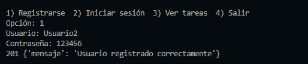
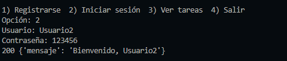
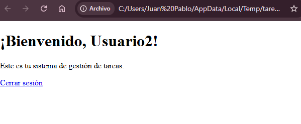
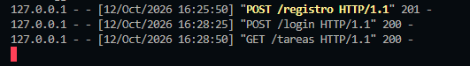
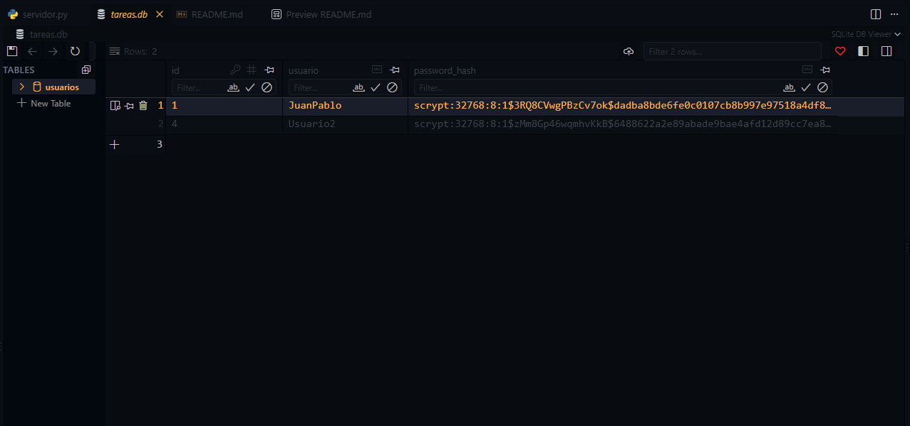

# PFO 2: Sistema de Gestión de Tareas con API y Base de Datos

API REST en Flask con persistencia en SQLite, contraseñas hasheadas y un cliente de consola.

## Requisitos
- Python 3.9+
- `pip install -r requirements.txt`

## Ejecución
1. Iniciar el servidor desde la terminal escribiendo: `python servidor.py` (inicia en http://127.0.0.1:5000; crea automaticamente la base de datos `tareas.db`).
2. Desde el navegador: abrir http://127.0.0.1:5000/ , registrarse e iniciar sesión (redirige a `/tareas`).
3. Desde la consola, en otra terminal escribir: `python cliente.py`, mostrará las opciones de (1) Registrarse, (2) Iniciar Sesion, (3) Lista de tareas, (4) Salir.

## Endpoints
| Método | Ruta | Descripción |
|---|---|---|
| GET | `/` | Página con formulario de registro e inicio de sesión, solo cuando lo iniciamos desde el navegador |
| POST | `/registro` | Recibe `{"usuario": "...", "contraseña": "..."}` y guarda el hash en SQLite |
| POST | `/login` | Verifica credenciales e inicia sesión |
| GET | `/tareas` | HTML de bienvenida (requiere sesión iniciada) |

## Capturas de pantalla
### Registro de usuario desde CONSOLA:

### Login de usuario desde CONSOLA:

### Pagina de Bienvenida:

### Mensajes del servidor mientras se ejecutan las peticiones:

### Base de datos con usuarios registrados y sus contraseñas HASH

## Libreria para hashear claves
Se utiliza werkzeug.security que viene incluida en Flask para hashear contraseñas con scrypt y sal aleatoria.

## Respuestas conceptuales

**¿Por qué hashear contraseñas?**
Si la base de datos se filtra, las contraseñas en texto plano quedan expuestas y, como mucha gente las reutiliza, comprometen otras cuentas. Un hash es una función de un solo sentido: no se puede revertir, y al llevar sal (salt) cada hash es distinto aunque dos usuarios tengan la misma contraseña. Para validar, se hashea lo ingresado y se compara con el guardado. Ni siquiera el administrador conoce la contraseña.

**Ventajas de usar SQLite en este proyecto**
- No requiere servidor ni configuración: es un único archivo (`tareas.db`).
- Viene incluido en Python (módulo `sqlite3`), sin dependencias extra.
- Es liviano y suficiente para un proyecto pequeño con pocos usuarios.
- Soporta SQL estándar y transacciones, y es fácil de copiar y respaldar.

## GitHub Pages
GitHub Pages solo aloja contenido estático, por lo que no puede ejecutar Flask. Se publica en Pages este README con la documentación y las capturas; el servidor se ejecuta localmente.
